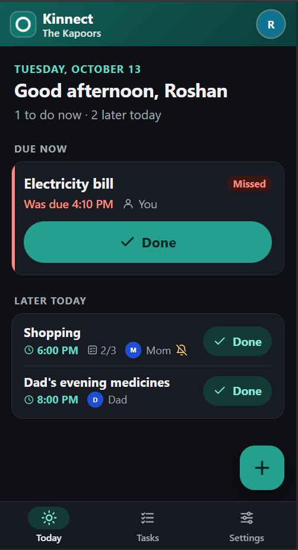

# Kinnect

A family task tracker for the things that can't be forgotten: Dad's evening medicines, the
household shopping list, the electricity bill. Everything is one kind of task, with optional
repeats, reminders and checklists. Family members can watch a task, so if a medicine dose is
missed, the son in another city gets an alert. Changes show up instantly on every phone. Kinnect
installs from the browser on Android and iPhone, has no passwords (members join with a link),
collects no email addresses or phone numbers, and runs on Cloudflare's free plan, so it costs
nothing to host.

<p align="center"></p>

**Features**

- Tasks with due dates, repeats (daily, weekly, monthly, every n days/weeks/months) and
  checklists
- Push reminders before and at the due time; missed alerts go to everyone watching the task
- Households: tasks shared by the people under one roof, private from the rest of the family
- Live updates across phones, and a simple view with large text for members who only tick
  things off
- Admins can download all the family's data as JSON at any time

Kinnect is self-hosted: there's no public instance to sign up to. One deployment can hold several
families, created by whoever runs it.

## Deploy your own

**You need**

- [Node.js](https://nodejs.org/) 22.18 or newer
- A free [Cloudflare](https://dash.cloudflare.com/sign-up) account (no credit card)
- Phones: Chrome on Android, or Safari on iPhone with iOS 16.4 or newer

**Steps** (the full guide, with updating, backups and recovery, is in
[docs/deploy.md](docs/deploy.md))

```sh
git clone https://github.com/kraft360/kinnect.git && cd kinnect
npm install
npx wrangler login                    # sign in to Cloudflare in the browser
npm run vapid                         # push keys: public → wrangler.jsonc, private → .dev.vars
npm run operator -- init-secret       # adds OPERATOR_SECRET to .dev.vars
echo "APP_URL=https://kinnect.<your-subdomain>.workers.dev" >> .dev.vars
npm run build && npx wrangler deploy --secrets-file .dev.vars
npm run operator -- create-org        # prints a one-time link to create your family
```

`<your-subdomain>` is your account's workers.dev subdomain, shown in the Cloudflare dashboard under
**Workers & Pages** (you choose it the first time you open that page). `kinnect` is the `name` in
`wrangler.jsonc`.

Open the printed link on the phone of the person who will own the family. From there, the app
walks you through adding members and setting up their phones.

Keep `.dev.vars` safe: it holds your push and operator keys, and it's not in git.

## Development

```sh
npm install
npm run vapid        # once: creates VAPID keys (.dev.vars, wrangler.jsonc)
npm run dev          # app with hot reload, Worker and Durable Objects at http://localhost:5173
npm run check        # generates Worker types (wrangler types), then type checks Worker and web app
npm test             # tests
npm run format       # formats code with Prettier (CI checks this)
```

Schema changes: add a new entry to the end of `orgMigrations` or `directoryMigrations`; never edit
a deployed migration. New columns also go in `EXPORT_PLAN` (`src/worker/org/export.ts`).

| Path | What it is |
|---|---|
| `src/worker/index.ts` | Worker entry: `/api/*` routes; signed-in requests go to the family named in the session cookie |
| `src/worker/org/` | `OrgDO` (one per family), its schema, tasks, scheduler, live sync and data export |
| `src/worker/directory/` | `DirectoryDO` (global lookups: join codes, operator links, rate limits) and its schema |
| `src/worker/db/migrate.ts` | Applies numbered schema migrations when a Durable Object starts |
| `src/worker/push/` | Web Push in WebCrypto (RFC 8291 encryption, RFC 8292 VAPID) |
| `src/shared/` | Code and types used by both the Worker and the web app |
| `src/web/` | Svelte app: `screens/`, shared `components/`, live data (`sync.svelte.ts`) and phone setup (`setup.svelte.ts`); `src/web/public/` has the service worker, manifest and icons |
| `scripts/` | `npm run vapid` (push keys) and `npm run operator` (create-family and owner-recovery links) |
| `test/worker/`, `test/shared/` | Tests that run in the Workers runtime |

## Documentation

- [docs/requirements.md](docs/requirements.md): requirements and architecture
- [docs/deploy.md](docs/deploy.md): deploying, updating, backups, recovery and monitoring
- [SECURITY.md](SECURITY.md): trust model and reporting vulnerabilities
- [docs/history/](docs/history/): notes from development, such as the push-delivery experiment

## License

[MIT](LICENSE)
