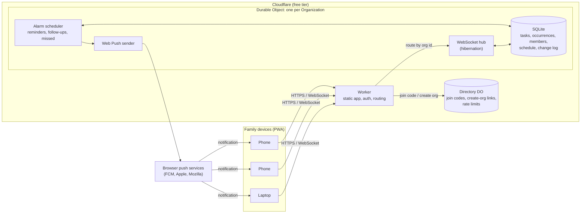
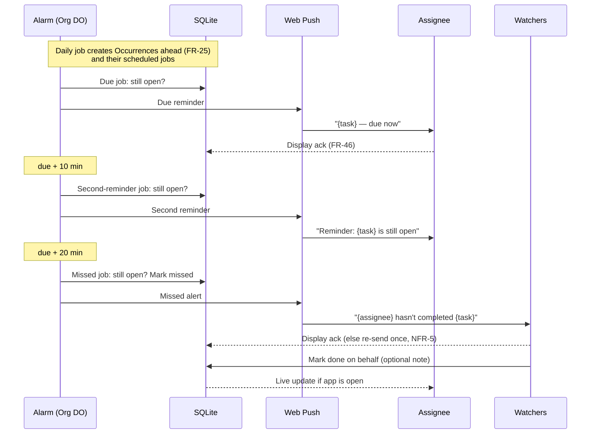
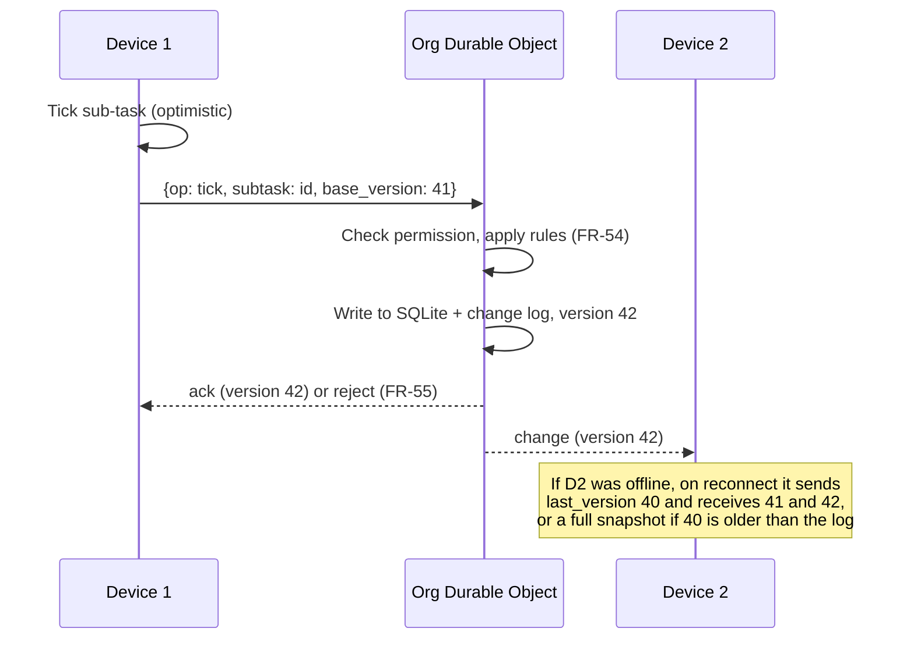
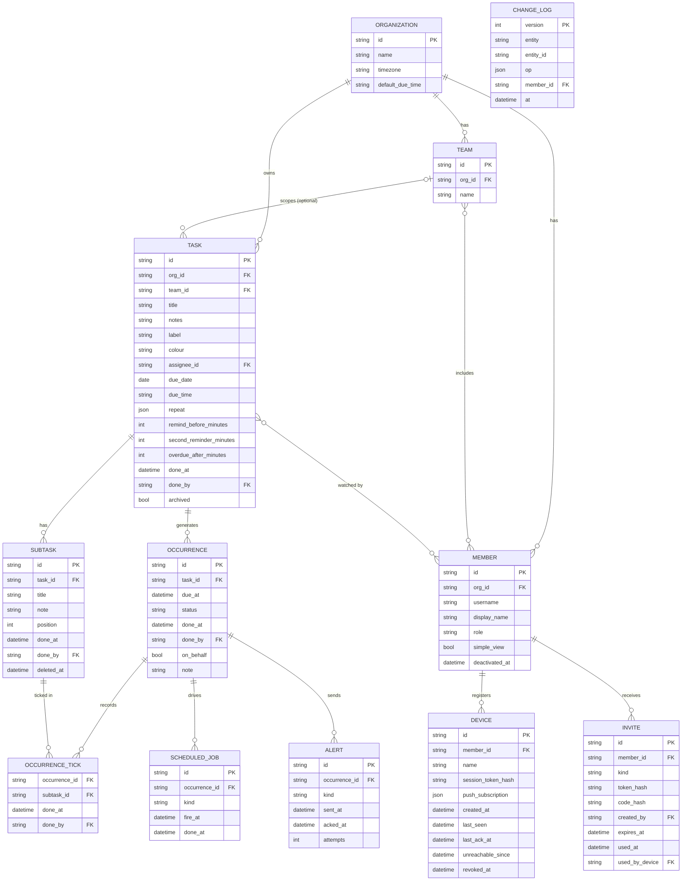

# Kinnect — Family Task Tracker: Requirements & Architecture

| | |
|---|---|
| **Status** | Draft v6 — review gaps addressed |
| **Name** | Kinnect (personal project; no trademark check needed for now) |
| **Date** | 12 Oct 2026 |
| **Goal** | A zero-cost, real-time family task tracker in which every item, a daily medicine reminder, a shopping list or a monthly bill, is the same kind of Task |

---

## 1. Problem statement

The app must cover these real-life needs with **one generic Task model and one common interface**:

1. **Recurring personal tasks with oversight.** For example, a senior family member forgets to take medicines. They need a task that repeats on a schedule, which they mark as done, and family members elsewhere need an alert when it isn't done.
2. **Shared checklists.** For example, a household shopping list that everyone can add to and tick off, with changes visible instantly (like Google Keep).
3. **Dated reminders.** For example, monthly bills and one-off events.

None of these is a separate feature. Each is a Task with a different combination of optional properties (section 4.3).

## 2. Terminology

| App term | Real-world meaning | Scope |
|---|---|---|
| **Organization** | The **family** (extended family, possibly across several homes) | Top-level boundary. All sharing, watching and alerts happen inside one Organization. |
| **Team** | A **household** (people living under one roof) | Groups members who share day-to-day tasks such as a shopping list. |
| **Member** | A person | Belongs to one Organization and to zero or more Teams. Team membership is set only by an admin. |
| **Task** | Anything to be done | The only item type in the app. |
| **Sub-task** | A checklist item inside a Task | One level only. |
| **Occurrence** | One dated instance of a Task that has a due date or a repeat | E.g. "8:00 PM on 12 Oct". |

The family is the larger unit: a son in Bengaluru must be able to watch his father's task in another city. With **Family = Organization** and **Household = Team**, cross-household watching stays inside one Organization, and household tasks stay scoped to their Team. *(D1)*

## 3. Users and roles

| Role | Description |
|---|---|
| **Platform operator** | The person who deploys the app. Has no account inside any Organization. Holds a deploy-time secret used only to issue "create organization" links and admin recovery links. |
| **Org owner** | The member who created the Organization, or to whom ownership was transferred (FR-91). An admin who cannot be removed or deactivated by other admins. |
| **Org admin** | Creates, renames and deletes Teams; adds members to and removes them from Teams; creates and deactivates members; issues invite and "add device" links; revokes devices; can edit any task; can promote or demote other admins; can export the Organization's data. |
| **Member** | Creates and edits tasks in the Organization and in Teams they belong to, completes tasks, can be an assignee or watcher. Cannot create Teams or change Team membership. |

**Assignee** and **Watcher** are per-task relationships, not account types. The same person can be the assignee on one task and a watcher on another.

## 4. Functional requirements

### 4.1 One Task type

| ID | Requirement |
|---|---|
| FR-1 | There is **one item type: Task**. There are no system task types or categories. *(D7)* |
| FR-2 | A Task may contain **Sub-tasks** (a checklist). Nesting is limited to two levels: Task → Sub-task. |
| FR-3 | All behaviour (reminders, repetition, follow-up, alerts) is driven by which **optional properties** are set on the Task (4.2), never by a type. |
| FR-4 | Members may add an optional **label and colour** to a Task for visual grouping (e.g. "Health", "Groceries"). Labels are user-defined and have no effect on behaviour. |

### 4.2 Task properties

Only **title** is required. Everything else is optional and revealed progressively in the editor.

| Property | Meaning | Default |
|---|---|---|
| Title, notes | What the task is | — |
| Scope | Visible to the whole Organization, or to one Team the creator belongs to | Organization |
| Sub-tasks | Checklist items, each with an optional note or quantity | None |
| Assignee | The person expected to complete it | None (anyone in scope can complete it) |
| Watchers | Members alerted if it is not completed in time | None |
| Due | A single date and time. If no time is chosen, the Organization's **default time** (09:00) is filled in (FR-24). | None |
| Repeat | A schedule: times of day + every day, chosen days of the week, or a day of the month. Can be **every n days, weeks or months** (e.g. every other day, fortnightly, quarterly), counted on **fixed days** from a start date: a late or missed completion does not shift the cycle. If no time is chosen, the default time is used. | None |
| Remind before | Lead time for an advance reminder (e.g. 3 days) | None |
| Second reminder | Minutes after due to remind again if not done | 10 min *(D3)* |
| Overdue after | When an open Occurrence is marked missed and watchers are alerted: a number of minutes after due, or **Never** | 20 min *(D3)* |
| Label, colour | Visual grouping only | None |

### 4.3 How the original use cases map to properties

| Use case | Properties set | Resulting behaviour |
|---|---|---|
| Dad's evening medicines | Repeat: daily 20:00 · Assignee: Dad · Watchers: two children · Scope: Organization · Sub-tasks: tablet names (for reference) | Dad is reminded at 20:00 and again at 20:10. If not done by 20:20, his children are alerted. If Dad completes it later, they are told (FR-22). |
| Alternate-day medicine | Repeat: every 2 days at 09:00 from a start date · Assignee: Mom · Watchers: Dad | Reminders on the start date and every second day after it, on the same days whenever the dose is taken. Missed doses alert Dad as for any task. |
| Household shopping list | Scope: home Team · Sub-tasks: items | Stays open indefinitely. Anyone in the household adds and ticks items live. |
| Electricity bill | Repeat: monthly on the 5th (default time 09:00) · Remind before: 3 days · Overdue after: 1 day · Assignee: Mom | Reminders at 09:00 on the 2nd and the 5th, and again at 09:10 on the 5th; marked missed at 09:00 on the 6th if not done. |
| Cousin's wedding | Due: a date (default time 09:00) · Remind before: 7 days · Overdue after: Never | One advance reminder and one on the day. Never marked missed. |
| "Fix the tap" | Title only | A plain to-do. |

### 4.4 Generic behaviour rules

| ID | Requirement |
|---|---|
| FR-10 | **No due and no repeat:** the Task stays open until someone marks it done or archives it. It never becomes overdue. |
| FR-11 | **Due or repeat set:** each due point is an **Occurrence**. A one-off Task has one Occurrence; a repeating Task gets one per scheduled time. Each Occurrence is completed independently. |
| FR-12 | A reminder is sent to the assignee at *due − remind before* (if set) and at the due time. If there is no assignee, it goes to everyone in the Task's scope. |
| FR-13 | If the Occurrence is still open at *due + second reminder*, the reminder is repeated. |
| FR-14 | If still open at *due + overdue after*, the Occurrence is marked **missed** and all watchers are alerted. Without watchers it is just shown as missed. With Overdue after = Never, it stays open until done or until the next Occurrence of the same Task is due; it is then shown as missed without alerting anyone. |
| FR-15 | **One "Done" action** completes a Task or Occurrence. Ticking sub-tasks is optional and never required to mark it done. *(D2)* |
| FR-16 | A Task never auto-completes when all its sub-tasks are ticked (so a shopping list stays open). |
| FR-17 | Sub-task controls are the same everywhere: add, edit, tick, untick, reorder. Unticked items sort above ticked ones. On Tasks without Occurrences, "Clear completed" hides ticked items; they are kept (soft-deleted) for history and suggestions. On Tasks with Occurrences, ticks belong to one Occurrence and each new Occurrence starts with all items unticked, so "Clear completed" is not offered. |
| FR-18 | A watcher can **mark an Occurrence done on the assignee's behalf**, with an optional note. The record shows who completed it. |
| FR-19 | Every completion records who did it and when. Each Task shows its history: done on time, done late, missed, or done on someone's behalf. |
| FR-20 | Tasks can be archived. Archived tasks keep their history, and all their pending reminders are cancelled. |
| FR-21 | **One place for completion state.** A Task without Occurrences stores done / ticked state on the Task and its Sub-tasks. A Task with Occurrences stores it only on the Occurrence and its ticks; the Task itself is never "done", only archived. |
| FR-22 | **Late completion.** If a missed Occurrence is later marked done, it becomes **done late** and the watchers who were alerted are told. The completion time is the time the member tapped Done (device clock, capped at the server's receive time), so an offline completion made before the deadline counts as on time, and any missed alert already sent is followed by a "done" notice. |
| FR-23 | **Editing a schedule.** Changing due, repeat or follow-up settings affects only Occurrences that are still in the future. Past Occurrences and their history are unchanged. Open future Occurrences that no longer match the new schedule are deleted and recreated. Removing a Sub-task keeps its ticks in past Occurrences' history. |
| FR-24 | **Every due point has a time.** If the member picks only a date (e.g. a birthday or a bill), the editor fills in the Organization's **default time** (an admin setting, default 09:00), which the member can change. From then on the same rules apply as for any other Task: reminder at due, second reminder and missed alert per the Task's settings (defaults 10 and 20 min, D3). Days of month that don't exist (e.g. 31st in February) fall on the last day of that month. |
| FR-25 | **Occurrences are created in advance** over a rolling window (at least the next 2 days, or longer if Remind before needs it), so the Today screen can show upcoming items and advance reminders can be scheduled. |

### 4.5 Common interface

| ID | Requirement |
|---|---|
| FR-30 | **Today** (home screen): everything due today for the current member plus anything overdue, sorted by time, each with a large **Done** button. |
| FR-31 | **Tasks**: all tasks in the member's Teams and Organization, filterable by label, assignee and Team. |
| FR-32 | **Task detail**: the same layout for every task: title, checklist, schedule, people, history. Sections with nothing set are hidden. |
| FR-33 | **Task editor**: one form. Title first; optional properties are added with simple chips ("+ Checklist", "+ Repeat", "+ Assign", "+ Watchers", "+ Remind before"). |
| FR-34 | **Simple view**: a per-member setting that shows only the Today screen with large text and Done buttons. Intended for members who only need to complete tasks, not manage them. Admins can switch it on or off for a member (it applies to their phone at once); the member can leave it from the bottom of the screen. |
| FR-35 | All in-app and notification wording is generic (4.6). Nothing in the app is specific to medicines, shopping or bills. *(D8)* |

### 4.6 Notifications

| ID | Requirement |
|---|---|
| FR-40 | The only channel is **Web Push** to every registered device of a member (a member may register several devices). |
| FR-41 | No email or SMS alerts. The app stores no email addresses or phone numbers. *(D4)* |
| FR-42 | The app shows a warning when notifications are disabled on the current device, and watchers can see which assignees have no reachable device. A device is **unreachable** when it has no push subscription, its push service rejected the last message (FR-45), or notifications have been sent to it without any being shown (FR-46) for more than 24 hours. A member is reachable if any of their devices is. |
| FR-43 | **No quiet hours.** All notifications are delivered whenever they fall due. *(D6)* |
| FR-44 | Where the platform supports notification actions (Android Chrome; not iOS), the reminder includes a **Done** button. |
| FR-45 | **Push delivery settings.** Every push is sent with `Urgency: high` and a `TTL` that matches its purpose (reminders: until the next follow-up step; missed alerts: 12 hours). A `404` or `410` from a push service deletes that subscription and marks the device unreachable. |
| FR-46 | **Display acknowledgement.** When the service worker shows a notification, it reports back to the server (`POST /api/alerts/ack` with the alert id, using the device's session). The server records, for each alert, whether at least one recipient device showed it (used by NFR-5 and FR-42). The notification's Done button uses the same endpoint. |
| FR-47 | **Assignment changes that widen reminders.** When a Task becomes unassigned (FR-84, FR-90), its reminders go to everyone in scope (FR-12). The admin's confirmation screen states this for each affected Task. |

Notification wording (all generic):

| Event | Recipient | Text |
|---|---|---|
| Advance reminder | Assignee (or scope) | "{task} is due {date/time}" |
| Due | Assignee (or scope) | "{task} — due now" |
| Second reminder | Assignee (or scope) | "Reminder: {task} is still open" |
| Missed (assigned) | Watchers | "{assignee} hasn't completed {task} (due {time})" |
| Missed (unassigned) | Watchers | "{task} wasn't completed (due {time})" |
| Done late | Watchers who were alerted | "{member} completed {task} (due {time})" |
| Done on behalf | Assignee and other watchers | "{watcher} marked {task} done for {assignee}" |

### 4.7 Real-time sync and offline

| ID | Requirement |
|---|---|
| FR-50 | Live updates use a WebSocket that is open only while the app is in the foreground. |
| FR-51 | Edits are applied optimistically on the device, confirmed by the server, then broadcast to other connected devices. Target: under 1 second. |
| FR-52 | On reconnect the client sends its last known version and receives all changes since. If that version is older than the server's change log (8.1), or more changes were made since than there are Tasks, the client receives a full snapshot instead: each change carries a whole Task, so past that point a snapshot is smaller. |
| FR-53 | Edits made offline are queued on the device and sent on reconnect. |
| FR-54 | **Conflict rules.** Task and Sub-task fields: the last write received by the server wins, per field. Sub-task add, tick, untick and reorder are applied as individual operations, so concurrent changes to different items all survive. Completing an Occurrence: the first Done wins; later Done actions are recorded in history but don't change who completed it. |
| FR-55 | **Rejected edits.** The server rejects an edit the member is no longer allowed to make (e.g. removed from the Team, Task deleted). The device rolls the edit back and shows a short message saying what was not saved. |

### 4.8 Organization creation

| ID | Requirement |
|---|---|
| FR-60 | There is **no open sign-up**. Only the platform operator can start a new Organization. *(D9)* |
| FR-61 | The operator generates a single-use **"create organization" link** using a deploy-time secret (via a CLI command or a protected endpoint). The link expires after 7 days. |
| FR-62 | Whoever opens that link enters the Organization name and timezone and chooses their own username and display name. They become the **Org owner**, and their device is signed in. |
| FR-63 | No Team is created automatically. The owner creates Teams and members (4.10). The app prompts the owner to appoint **at least one more admin**, so the Organization is not locked out if the owner loses their phone. |
| FR-64 | **Recovery:** if no admin can sign in, the operator can generate a single-use admin "add device" link for that Organization. |

### 4.9 Members, invite links and devices (no passwords)

| ID | Requirement |
|---|---|
| FR-70 | There are **no passwords**. A device is signed in by opening a personal invite link. *(D5)* |
| FR-71 | An admin first creates the member record: **username** (unique within the Organization), display name and role. No email or phone number is collected. The member starts in **no Team**; Teams are assigned separately (4.10). |
| FR-72 | The admin then generates an **invite link** for that member, which carries a single-use token and a matching **short code** (e.g. `K7M-42Q`). The admin shares it by any means, e.g. a family chat. |
| FR-73 | Opening the link shows a page that names the member ("Join as Dad?"). The token is consumed **only when the button is tapped**, never on page load, so chat-app link previews cannot use it up. |
| FR-74 | On joining, the device receives a long-lived session (e.g. 1 year, renewed on use) and registers for push notifications. The session is stored in an **HttpOnly, Secure cookie** (not in page storage), so the service worker's notification actions are authenticated too. |
| FR-75 | **Installed app on iPhone:** because Home Screen apps don't share Safari's storage, the installed app offers "Enter join code", which accepts the short code instead of the link. Codes are unique across all Organizations, so no Organization needs to be entered. |
| FR-76 | Invite tokens expire after **48 hours** (configurable) and are single-use. Tokens and codes are stored only as hashes. |
| FR-77 | **New phone or cleared browser data:** an admin issues an **"add device" link** for the existing username. This is the same mechanism as an invite and replaces password reset. |
| FR-78 | Each member has a device list showing device name, sign-in date, last seen and reachability (FR-42). Admins (and the member) can revoke any device; its session ends immediately and open WebSockets are closed. |
| FR-79 | Joining with a code is rate-limited per IP address and globally: 30 attempts per IP per hour (a household joining from one Wi-Fi shares an IP) and 300 per hour in total. Codes are not locked individually: a wrong guess can't be attributed to any particular code. |
| FR-79a | **In-app browsers.** If the join page is opened inside a chat app's built-in browser (e.g. WhatsApp, Instagram), it does not offer the Join button. It asks the member to open the link in Chrome (Android) or Safari (iPhone) first, because push and install don't work in those browsers. |

### 4.10 Teams (admin-managed)

| ID | Requirement |
|---|---|
| FR-80 | **Only admins** can create, rename and delete Teams, and add or remove members. Members cannot create Teams or change membership. *(D10)* |
| FR-81 | There is **no default Team**. A new Organization has none, and a new member belongs to none until an admin adds them. |
| FR-82 | A member may belong to any number of Teams, including none. A member in no Team still sees and works on Organization-scoped tasks. |
| FR-83 | When a member is **added** to a Team, they immediately see that Team's tasks (live update on their open devices). |
| FR-84 | When a member is **removed** from a Team, they immediately lose access to its tasks. Before confirming, the admin sees the Team tasks where that member is assignee or watcher, and which reminders will now go to the whole Team (FR-47). On removal, they are removed as watcher and those tasks become **unassigned**. Their completion history is kept. |
| FR-85 | **Deleting a Team** requires confirmation. Its open tasks are archived with their history; the admin may instead move them to Organization scope. The Team is marked deleted rather than removed, so archived tasks keep their Team and stay visible only to admins, not to the whole family. Its name can be reused. |
| FR-86 | Assignees and watchers on a Team-scoped task must be members of that Team. On an Organization-scoped task, any member can be assignee or watcher. |
| FR-87 | A Team-scoped task can be created by members of that Team. Admins can create, view and edit tasks in every Team, including Teams they don't belong to. |

### 4.11 Member lifecycle and data export

| ID | Requirement |
|---|---|
| FR-90 | **Deactivating a member.** An admin can deactivate any member except the owner. All their devices are revoked, they are removed from all Teams and watcher lists, and their tasks become unassigned (with the same preview as FR-84). Their history is kept under their display name. A deactivated member can be reactivated with a new "add device" link; their username stays reserved. |
| FR-91 | **Ownership transfer.** The owner can transfer ownership to another admin and becomes an ordinary admin. The owner must transfer ownership before they can be deactivated. |
| FR-92 | **Export.** An admin can download all of the Organization's data (tasks, occurrences, history, members, Teams) as a JSON file. Session tokens and push subscriptions are excluded. |
| FR-93 | **Retention.** Finished history older than `PURGE_HISTORY_DAYS` (default 90) and internal scheduler and sync rows older than `PURGE_SYSTEM_DAYS` (default 10) are deleted automatically (8.3). Tasks (including archived ones), members, Teams, invites and devices are never deleted by it. |

## 5. Non-functional requirements

| ID | Requirement |
|---|---|
| NFR-1 | **Zero running cost.** Everything runs on free tiers; no credit card required. |
| NFR-2 | **Accessible by default.** Large tap targets, large fonts, high contrast, minimal typing. Regional-language labels later. |
| NFR-3 | **Installable.** Works as a PWA on Android (Chrome) and iPhone (Safari, added to Home Screen, iOS 16.4+). |
| NFR-4 | **Time correctness.** All timestamps stored in UTC. The Organization has a timezone (default `Asia/Kolkata`) used for schedules and display. In timezones with daylight saving, a scheduled local time that doesn't exist moves forward to the first valid time, and a time that occurs twice uses the first one. |
| NFR-5 | **Alert reliability (best effort).** Web Push gives no delivery guarantee, so the app does the following: missed alerts go to every device of every watcher; if no watcher device acknowledges a missed alert (FR-46) within 10 minutes it is sent once more; and the Task history shows "alert not delivered" if it is still not acknowledged. |
| NFR-6 | **Privacy.** Data is visible only to members of the Organization. No email addresses or phone numbers collected. No third-party analytics. |
| NFR-7 | **Scale.** A handful of Organizations with roughly 2–15 members each. |
| NFR-8 | **Data safety.** Rely on Durable Object point-in-time recovery for accidental changes, and on the admin export (FR-92) for an off-platform copy. |

## 6. Suggested stack

| Layer | Choice | Reason |
|---|---|---|
| Client | PWA built with React or Svelte | Installable, supports Web Push, one codebase for all phones |
| Hosting + API | **Cloudflare Worker** (with static assets) | Serves the app and API from one project. Free plan allows 100,000 requests/day; static asset requests are free. |
| Data, live sync, scheduling | **One Durable Object per Organization** (SQLite-backed) | Built-in SQLite storage, WebSockets with hibernation, and alarms for due times. SQLite-backed Durable Objects are available on the Workers Free plan. |
| Global lookups | **One Directory Durable Object** (SQLite-backed) | Holds the few things that are not inside any Organization (7.4). |
| Push | Web Push (VAPID) sent from the Organization Durable Object, implemented with WebCrypto (RFC 8291 / RFC 8292) | Free; no third-party service. The common `web-push` npm package depends on Node crypto, so use a WebCrypto-based library or a small own implementation. |
| Auth | Passwordless: single-use invite links / codes, long-lived per-device session tokens (hashed, stored in the Org's SQLite) | No email, phone or password needed |
| Tooling | `wrangler` CLI, TypeScript | Standard Cloudflare tooling |

### Alternatives considered

| Option | Why not chosen |
|---|---|
| Supabase (free) | Free projects pause after 7 days of inactivity, a risk for always-on alerts. |
| Firebase (Spark) | Scheduled functions require the paid Blaze plan. |
| Vercel (Hobby) | Functions cannot hold WebSocket connections, and Hobby cron is too infrequent for timely reminders. |
| Polling instead of WebSockets | Simpler, but WebSockets are free here and give instant updates. |
| Client-side timers instead of push | Browsers suspend background PWAs (iOS almost immediately), and there is no browser API for scheduled notifications, so reminders wouldn't fire when the app is closed. A watcher's device also can't know the assignee missed a task; only the server can. |
| Telegram bot alerts | Not used in the household. |
| Email alerts / email login | No email addresses are to be collected. |
| PIN login | Too easy to guess. |
| Username + password | Replaced by personal invite links; no passwords to forget or reset. *(D5)* |
| Open sign-up for Organizations | Would let anyone consume the free-tier quota. *(D9)* |
| Separate task types (routine, list, bill…) | Replaced by one Task with optional properties. *(D7)* |

## 7. Architecture

### 7.1 Component diagram

### 7.2 Request routing

- **Session token** (opaque, in an HttpOnly cookie) format: `<orgId>.<deviceId>.<random>`. Only the random part is the credential; the Organization stores its SHA-256 hash. Signed-in requests (`/api/...`) carry no Organization id in the path: the Worker reads it from the token and calls that Organization's Durable Object, which checks the hash. No global lookup is needed. An opaque token is used instead of a JWT so that revoking a device (FR-78) takes effect on its next request.
- **Invite link** contains the Organization id and the token, so it is routed the same way.
- **Join code** (FR-75) has no Organization id. The Worker asks the Directory DO, which maps the code's hash to an Organization id and enforces the rate limits in FR-79.
- **"Create organization" links** are verified by the Worker with the deploy-time secret; the Directory DO records that each one has been used.

### 7.3 Scheduler

A Durable Object has only **one alarm** at a time, so the Organization DO keeps its own job table:

- `SCHEDULED_JOB` rows (8.1) hold every pending step: advance reminder, due reminder, second reminder, missed check, alert re-send (NFR-5), and the daily job that creates Occurrences ahead of time (FR-25).
- The alarm is always set to the earliest pending `fire_at`. Inserting, deleting or running a job resets it.
- **Alarms may run more than once.** Each job is marked done in the same transaction as its effect, and every step re-checks the Occurrence's status first, so a repeated run never sends a duplicate or marks a done Occurrence as missed.
- Archiving a Task, deleting a Team or editing a schedule deletes the affected pending jobs (FR-20, FR-23).
- **CPU budget.** Each push needs ECDH, HKDF, AES-GCM and an ES256 signature. The VAPID JWT is reused per push-service origin for up to 12 hours. Jobs don't send pushes themselves: they add them to a `push_queue` table in the same transaction as their effect. Each alarm run sends at most **40 queued pushes** (Phase 0 measured about 0.5–0.8 ms CPU per push; the cap keeps runs under the free plan's per-invocation subrequest limit) and sets the alarm to fire again immediately if more are waiting.
- **Window.** Repeating Tasks get Occurrences for the next 2 days (longer if Remind before needs it); a `materialize` job every 6 hours extends the window. A one-off Task gets its single Occurrence when its due date is set. Steps whose time has already passed when an Occurrence is created are skipped.

### 7.4 Directory Durable Object

A single SQLite-backed Durable Object for data that does not belong to one Organization:

- join code hash → Organization id, expiry and failed-attempt count;
- used "create organization" link ids;
- per-IP and global rate-limit counters for join attempts.

It holds no task, member or personal data. It is touched only when joining and when creating an Organization, so it is not a bottleneck.

### 7.5 Reminder and missed-task flow

### 7.6 Real-time edit flow

Edits are sent as single operations over HTTPS (`POST /api/ops`); the Organization's Durable Object applies each one, records it in the change log and pushes the resulting task to every open WebSocket that may see it. The WebSocket carries only server-to-device updates, so authentication and validation stay in one place, and the Phase 2 offline queue is a replay of the same HTTP operations.

## 8. Data model

### 8.1 Organization Durable Object

Notes:

- `team_id` null means the Task is scoped to the whole Organization (the default).
- The `TEAM`–`MEMBER` relationship is a membership table (`team_id`, `member_id`, `added_by`, `added_at`) changed only by admins. A member may have no rows in it.
- `due_time` is always set (the default time is filled in by the editor). `repeat` examples: `{"kind": "daily", "times": ["08:00", "20:00"]}`, `{"kind": "monthly", "day": 5, "times": ["09:00"]}`, `{"kind": "weekly", "days": ["SAT"], "times": ["09:00"]}`.
- `overdue_after_minutes` null means **Never**.
- `TASK.done_at` / `done_by` and `SUBTASK.done_at` are used only for Tasks without Occurrences. Tasks with Occurrences use `OCCURRENCE` and `OCCURRENCE_TICK` only (FR-21).
- `OCCURRENCE_TICK` records optional sub-task ticks within one Occurrence, so each Occurrence's checklist starts fresh.
- `SUBTASK.deleted_at` implements "Clear completed" and Sub-task removal as a soft delete (FR-17, FR-23).
- Occurrence `status`: `open`, `done`, `done_late`, `missed`.
- `SCHEDULED_JOB.kind`: `advance`, `due`, `second`, `missed`, `resend`, `materialize` (extends every task's window), `purge` (the daily purge, 8.3). The last two have no `occurrence_id`.
- `MEMBER.role`: `owner`, `admin`, `member`.
- `INVITE.kind`: `invite` (first device) or `add_device` (additional or replacement device). Both work the same way.
- `CHANGE_LOG` keeps the last `PURGE_SYSTEM_DAYS` of changes (8.3); clients that are further behind get a snapshot (FR-52).

### 8.2 Directory Durable Object

| Table | Columns |
|---|---|
| `join_code` | `code_hash` PK, `org_id`, `expires_at`, `failed_attempts` |
| `org_creation` | `link_id` PK, `used_at`, `org_id` |
| `rate_limit` | `key` (IP or `global`), `window_start`, `count` |

The Organization DO adds a `join_code` row when it issues an invite and deletes it when the invite is used, revoked or expired.

### 8.3 Purge

A recurring `purge` job in each Organization DO deletes old rows once a day (FR-93). Two deployment-wide settings in `wrangler.jsonc` set the windows:

| Setting | Default | Minimum | Table | Deleted when |
|---|---|---|---|---|
| `PURGE_HISTORY_DAYS` | 90 | 7 (the app shows 7 days of history) | `OCCURRENCE`, with its `ALERT`, `OCCURRENCE_TICK` and `SCHEDULED_JOB` rows | Not `open`, and due before the window |
| | | | `SUBTASK` | Soft-deleted before the window, and in no remaining `OCCURRENCE_TICK` |
| `PURGE_SYSTEM_DAYS` | 10 | 1 | `SCHEDULED_JOB` | Ran (`done_at`) before the window |
| | | | `CHANGE_LOG` | Logged before the window, oldest first, so the versions left stay consecutive |

- **Never purged:** Tasks (including archived ones), members, Teams, invites, devices, and the Directory's `operator_link`. Invites and operator links are the audit trail of who was invited and when the owner was recovered.
- **Batches:** each run deletes at most 500 rows per table. If any table had more, the next `purge` job is due straight away; otherwise a day later. Each run logs how many rows it deleted from each table.
- **Self-healing:** every alarm run adds a `purge` job if none is pending, so purging can't silently stop.
- **An invalid setting** (not a whole number, or below the minimum) is logged and the default is used.

## 9. Delivery phases

| Phase | Scope |
|---|---|
| **0. Spike** | Create a free Cloudflare account. Send Web Push from a Durable Object alarm to two Android phones and one iPhone. Measure CPU time per push on the free plan and set the per-run push limit (7.3). Confirm display acknowledgements arrive. |
| **1. MVP** | Operator "create organization" link, Directory DO, admin management of Teams, members and Team membership, invite / add-device links with join codes, generic Task with sub-tasks, due date and time (with default time), daily, weekly and monthly repeats including every n days, weeks or months, Remind before, labels and colours, reminders and missed alerts over Web Push with acknowledgements, Today/Tasks/Detail screens, live sync (edits need a connection; the app shows when it is offline), **simple view**, **notification-health warnings** with a "Set up this phone" checklist, **device list and revoke**, **data export** (FR-92) |
| **2. Polish** | Task history view, offline queue, sub-task suggestions from history, member deactivation and ownership transfer |
| **3. Extension** | More repeat patterns if needed (e.g. yearly, "nth weekday of the month", or counting from the last completion) |
| **4. Later** | Weekly summary to watchers, regional-language labels, passkeys, ntfy as an alternative push channel, one device signed in to several Organizations (D17), per-Organization wording for non-family groups (D16) |

Because there are no task types, the original "bills and events" phase is just repeat patterns and lead times; these moved into the MVP because they cost little once the scheduler exists. Simple view, notification-health warnings and device revoke are in the MVP because the main user (a senior member) needs simple view, and the risk mitigations in section 10 rely on the other two.

## 10. Risks

| Risk | Mitigation |
|---|---|
| Sending push exceeds the free plan's limits | Measured in Phase 0: about 0.5–0.8 ms CPU per push. VAPID JWT reuse; 40 pushes per alarm run (7.3) |
| Android battery optimisation delays or drops push on some phones (Xiaomi, Oppo, Vivo, Samsung; also seen on the Android phone used in Phase 0) | `Urgency: high` (FR-45); "Set up this phone" checklist, opened after joining, to set **Chrome's** battery use to Unrestricted (setting only the installed app is not enough) and to check the installed app's Android notification permission; escalation to watchers; multiple devices per member |
| iPhone push requires Home Screen install | Onboarding detects iOS and guides the install |
| Notifications blocked or lost after a phone reset | In-app warning, display acknowledgements and watcher-visible device status (FR-42, FR-46) |
| Web Push is the only alert channel | Watchers on several devices; one re-send of unacknowledged missed alerts (NFR-5); ntfy kept as a later fallback |
| Generic editor overwhelms members who only complete tasks | Simple view (FR-34); optional properties hidden until added (FR-33) |
| An invite link is forwarded to or intercepted by the wrong person before use | Single-use, 48-hour expiry, join page names the member, device list shows who joined, admin can revoke instantly |
| Chat apps' link previews consume the invite | Token is only consumed on button tap, never on page load (FR-73) |
| Invite opened in a chat app's built-in browser, where push doesn't work | Join page asks the member to open it in Chrome or Safari first (FR-79a) |
| iPhone Home Screen app doesn't share Safari's sign-in | Short join code entered in the installed app (FR-75) |
| Join codes guessed | Global uniqueness, hashing, per-IP and global rate limits, 48-hour expiry (FR-76, FR-79) |
| Member loses their only device | Admin issues an "add device" link (FR-77) |
| Every admin loses access | Owner is prompted to appoint a second admin; operator recovery link as last resort (FR-63, FR-64) |
| Operator's deploy-time secret leaks | Store it only as a Cloudflare secret; rotate it if exposed; it can only create Organizations or recovery links, not read data |
| Removing someone from a Team leaves its tasks without an assignee | Admin sees affected tasks and the widened reminders before confirming; tasks become unassigned and remain visible to the rest of the Team (FR-84, FR-47) |
| Alarm runs twice and sends duplicate alerts | Jobs are idempotent and re-check status (7.3) |
| A member is in no Team and sees an empty app | Organization-scoped tasks are the default, so they still see shared family tasks (FR-82) |
| Data lost by mistake or platform problem | Point-in-time recovery and admin export (NFR-8, FR-92) |
| A person in two Organizations (e.g. their own family and their parents') can use only one per device | Accepted for now (D17); the server design already allows several sessions per device later |
| Free-tier limits change | Usage is far below current limits; review yearly |
| Single Durable Object per Organization | Acceptable at family scale; SQLite data persists across restarts |

## 11. Review decisions

| # | Question | Decision |
|---|---|---|
| D1 | Naming | **Family = Organization, Household = Team.** |
| D2 | Completion | **One "Done" per Task or Occurrence**; ticking sub-tasks is optional. |
| D3 | Follow-up defaults | **Second reminder at due + 10 min; missed at due + 20 min** for every Task, including those created with only a date. Configurable per Task, including Never. |
| D4 | Email alerts | **No.** No email addresses or phone numbers collected. |
| D5 | Login | **No passwords.** Personal single-use invite links (with a short code) sign in a device; "add device" links replace password reset. |
| D6 | Quiet hours | **None.** |
| D7 | Task types | **None.** One Task type; behaviour comes from optional properties. |
| D8 | Wording | **Generic everywhere**: "Done", "hasn't completed", "marked done for". |
| D9 | Organization creation | **Operator only.** The deployer issues single-use "create organization" links; the person who uses one becomes the Org owner. No open sign-up. |
| D10 | Teams | **Admin-managed.** Only admins create Teams and add or remove members. No default Team; members start in none. Tasks default to Organization scope. |
| D11 | Tasks with only a date | **No special rules.** The editor fills in the Organization's default time (09:00); the Task then follows the same reminder and missed rules as any other. |
| D12 | Reminders vs. client timers | **Server-side scheduling and Web Push from the MVP.** Client-side timers can't fire while the app is closed. |
| D13 | Sync conflicts | **Last write wins per field; checklist changes as operations; first Done wins.** |
| D14 | Global lookups | **One Directory Durable Object** for join codes, create-org links and rate limits; session tokens carry the Organization id. |
| D15 | MVP scope | **Simple view, notification-health warnings and device revoke move into the MVP**; a push spike (Phase 0) comes first. |
| D16 | Names in code vs. on screen | **Code and data keep the generic names Organization and Team; screens say Family and Household.** Kinnect may later serve other small groups (clubs, flatmates); the on-screen words could then become a setting per Organization. |
| D17 | Several Organizations per device | **Not now.** A device is signed in to one Organization. Later: one session token per Organization in the cookie, plus a switcher in the app. The server already supports this (tokens carry the Organization id). |

## 12. Open questions

None at present. Phase 0 answered the CPU question: about 0.5–0.8 ms per push (see [history/spike-results.md](history/spike-results.md)).
